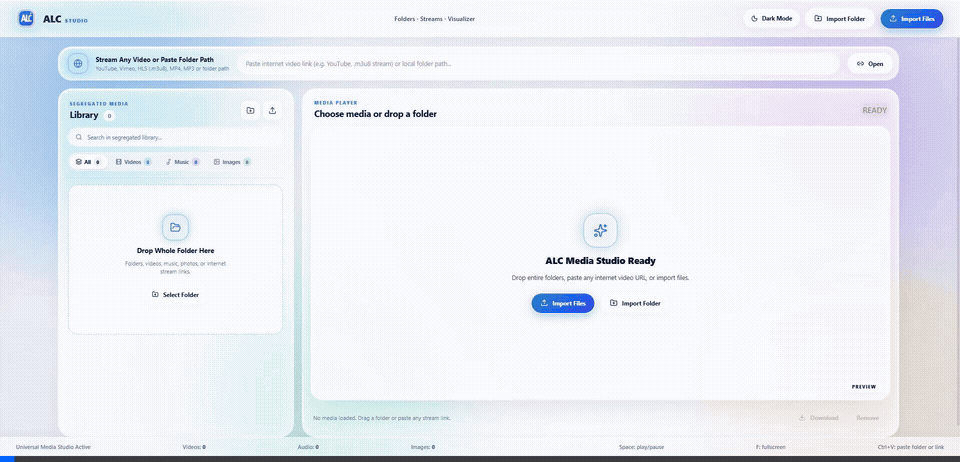
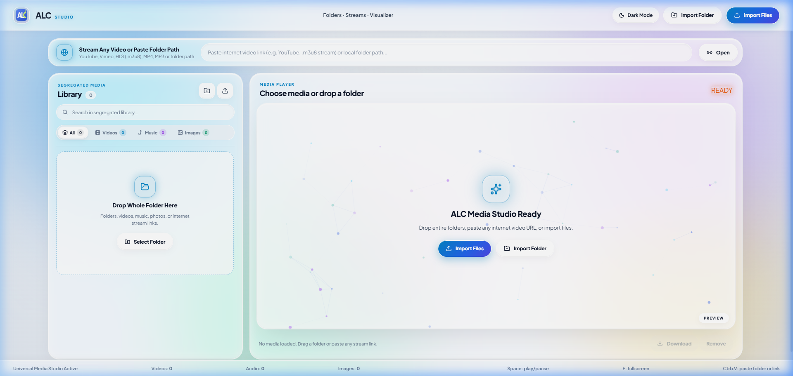
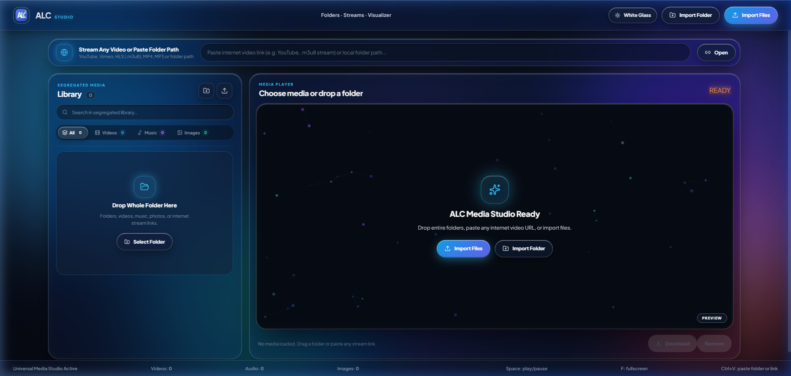
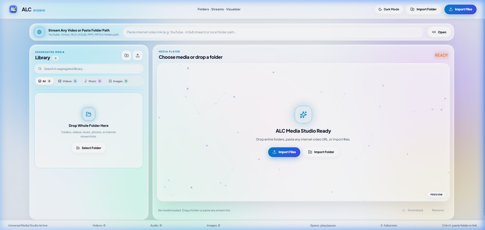

# 🎬 ALC Media Player

[](https://www.typescriptlang.org/)
[](https://react.dev/)
[](https://vitejs.dev/)
[](https://www.electronjs.org/)
[-brightgreen?logo=shield)](https://github.com/shivbu22)
[-0078D6?logo=windows&logoColor=white)](https://www.microsoft.com/windows)

**ALC Media Player** is a state-of-the-art, local-first PC media playback station engineered with a modern **White & Clear Transparent Liquid Glass** aesthetic, ultra-fast hardware-accelerated playback, YouTube & HLS internet streaming capabilities, and a native Windows installer.

---

## 📸 Testing Demonstration & Visual Showcase

### 🎥 Live Testing Session (Interactive Browser Recording)


*Automated end-to-end browser subagent test demonstrating instant playback controls, responsive theme toggling, and liquid glass surface depth.*

---

### 🖼️ High-Fidelity UI Gallery

| ⚪ White Clear Transparent Liquid Glass (Light Mode) | ⚫ Dark Nebula Glass (Dark Mode) |
| :---: | :---: |
|  |  |

---

### 🖥️ Full Player Overview


---

## ✨ Key Features & Capabilities

### 💎 White & Clear Transparent Liquid Glass Design
- **Curated Glassmorphism**: Ultra-modern frosted glass panels with specular micro-borders (`rgba(255, 255, 255, 0.7)`), multi-layered backdrop blur (18px–32px), and subtle diffuse illumination.
- **Dynamic Dual-Mode**: Seamless toggle between **White Clear Liquid Glass** and **Dark Nebula Glass** with zero layout shift and fluid CSS transitions.
- **Micro-Animations & Visual Hierarchy**: Tactile button responses, glowing active status indicators, and clean typography powered by *Plus Jakarta Sans* and *JetBrains Mono*.

### ⚡ High-Performance Media Playback
- **Privileged Streaming Protocol (`alc-media://`)**: Custom Electron protocol with full HTTP 206 Partial Content (Range Requests) for instant, stutter-free seeking across massive 4K MP4, MOV, MKV, and WebM files.
- **Hardware Acceleration**: Flags for zero-copy GPU rasterization, platform HEVC / H.265 platform decoding, and bypassed GPU blocklists.
- **Comprehensive Format Support**: MP4, MKV, MOV, WebM, AVI, M4V, TS, MP3, WAV, FLAC, AAC, OGG, Opus, and HLS live streams.

### 🌐 Universal Internet Media Integration
- **YouTube Embed Bypass**: Automated HTTP request header rewrite (`Referer: https://www.youtube.com/`) solving YouTube Error 153 in embedded players.
- **Direct Stream Ingestion**: Paste direct video, audio, or HLS `.m3u8` streams and play immediately.
- **Integrated Download Manager**: Built-in safe media downloader with HTTP/HTTPS redirect traversal and automatic progress resolution.

### 🎛️ Audio DSP & Intelligent Assistant
- **Real-Time Equalizer Presets**: Bass Boost, Vocal Clarity, Acoustic, and Treble optimization.
- **Spatial Audio Widening**: Simulated 3D soundstage for headphone listening.
- **AI Playback Assistant**: Contextual suggestions, media insights, and quick actions.

---

## 🔒 Security Audit & Vulnerability Assessment

The codebase has undergone a comprehensive vulnerability review and hardening pass:

| Security Vector | Implementation Details | Status |
| :--- | :--- | :---: |
| **NPM Dependencies** | `npm audit` executed across all production and dev dependencies. | **0 Vulnerabilities** |
| **Chromium Web Security** | `webSecurity: true` enforced; Same-Origin Policy strictly maintained. | **Hardened** |
| **Process Sandboxing** | `sandbox: true` and `contextIsolation: true` with strict `preload.cjs` contextBridge isolation. | **Hardened** |
| **Node.js Integration** | `nodeIntegration: false` prevents any renderer code from invoking native OS primitives directly. | **Protected** |
| **Content Security Policy** | Strict CSP in `index.html` allowing only verified protocols (`alc-media:`, `blob:`, `data:`, `self`). | **Active** |
| **Navigation Lock** | `will-navigate` blocks rogue navigation away from the bundled app; untrusted links delegate to external system browser. | **Restricted** |
| **Window Open Restrictions** | `setWindowOpenHandler` denies unauthorized Electron popup windows. | **Enforced** |
| **Filesystem Traversal Protection** | Directory scanner blocks root drive scans (`C:\`, `/`) and blacklists sensitive system folders (`Windows`, `System32`, `AppData`, `.ssh`, `.git`). | **Sanitized** |
| **Download Protocol Validation** | Download handler strictly verifies HTTP/HTTPS, sanitizes output filenames, and limits redirects to 5 to prevent DoS. | **Verified** |

---

## 🚀 Getting Started & Local Development

### Prerequisites
- [Node.js](https://nodejs.org/) (v18 or later recommended)
- `npm` or `yarn`

### Setup & Run
```bash
# Clone the repository
git clone https://github.com/shivbu22/alc-media-player.git

# Enter project directory
cd alc-media-player

# Install dependencies
npm install

# Start Vite development server
npm run dev
```

Open `http://localhost:5173/` in your browser.

---

## 📦 Building Windows Executable & Installer

### 1. Build Windows NSIS Setup Installer (Recommended)
Generates a complete Windows Setup Wizard (`.exe`) with desktop & start menu shortcuts, install directory selection, and clean uninstaller:
```bash
npm run installer:build
```
> Output located in: `dist-installer/ALC Media Player Setup 0.1.0.exe`
> Or simply double-click: **`Run Installer.bat`**

### 2. Build Portable Windows Executable
Generates an unpacked, standalone directory that runs anywhere without installation:
```bash
npm run desktop:portable
```
> Output located in: `dist-app/ALC Media Player-win32-x64/ALC Media Player.exe`
> Or simply double-click: **`Launch ALC Media Player.bat`**

---

## ⌨️ Keyboard Shortcuts

| Shortcut | Action |
| :--- | :--- |
| **`Space`** / **`K`** | Play / Pause media |
| **`Left Arrow`** / **`J`** | Seek backward 5 seconds |
| **`Right Arrow`** / **`L`** | Seek forward 5 seconds |
| **`Up Arrow`** | Volume +5% |
| **`Down Arrow`** | Volume -5% |
| **`M`** | Mute / Unmute audio |
| **`F`** | Toggle Fullscreen |

---

## 🛠️ Tech Stack & Architecture

- **Frontend**: React 19, TypeScript, Vite 8, Lucide React Icons
- **Desktop Shell**: Electron, Electron-Builder, Electron-Packager
- **Audio & Video Engine**: Native HTML5 Media API, Web Audio API, HLS.js
- **Design System**: Vanilla CSS Variables, Glassmorphism Backdrop Blur, Responsive Layout

---

## 📄 License

This project is licensed under the [MIT License](LICENSE).
